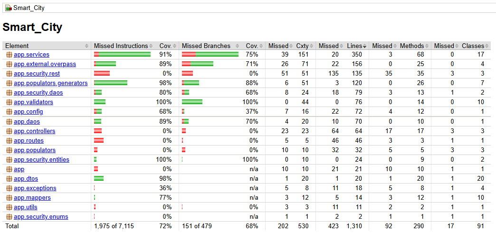
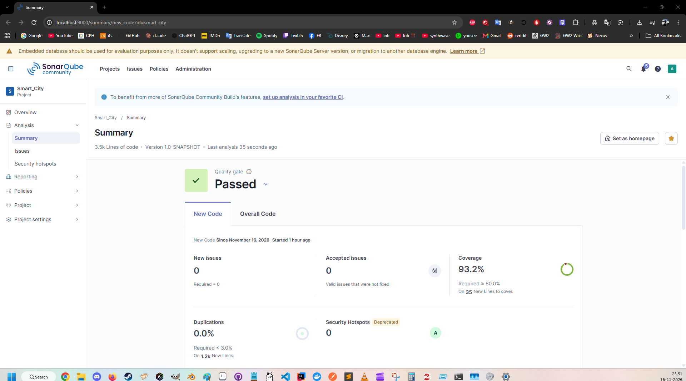
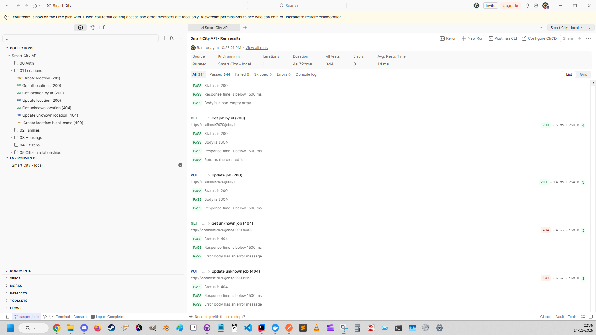
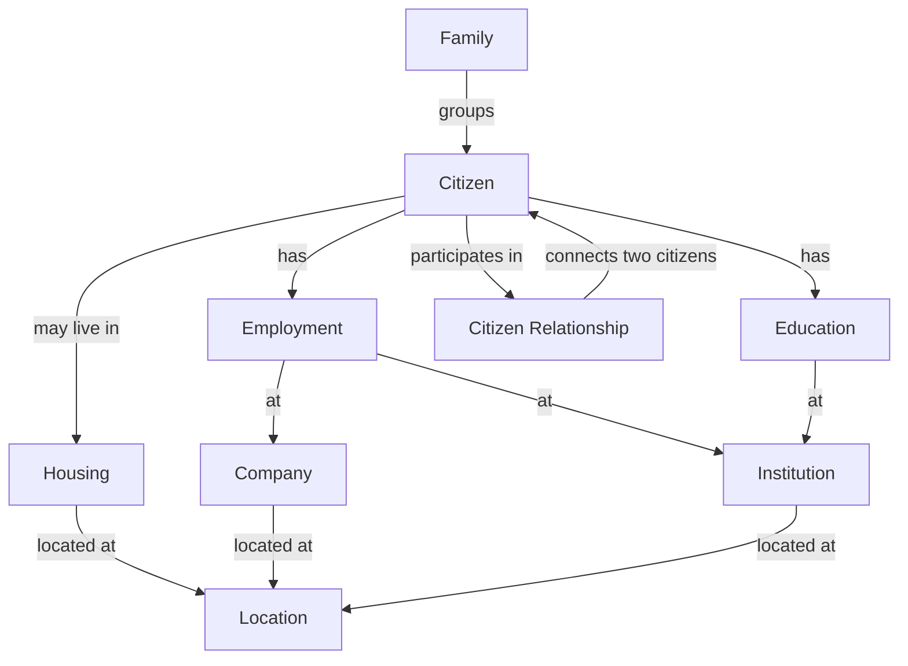
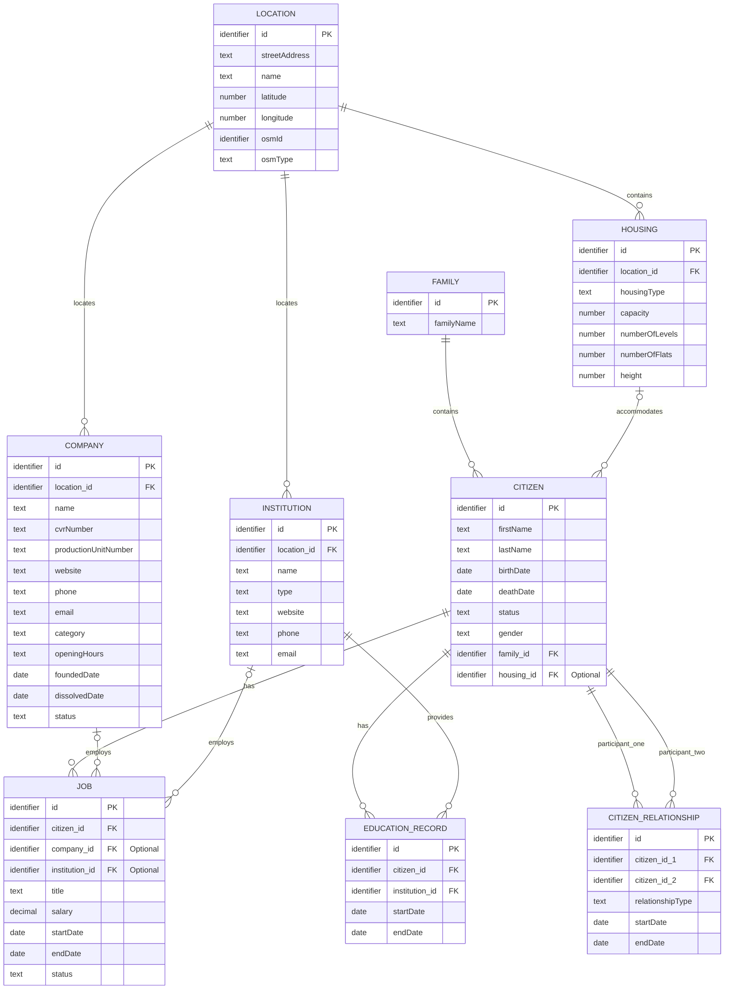

# Smart City

Smart City is a Java REST API for managing a simulated city: citizens, families, housing, locations, companies, institutions, jobs, education records, and citizen relationships. It uses a PostgreSQL database and includes JWT authentication, CRUD endpoints, nearby-place lookup through OpenStreetMap's Overpass API, and admin-only tools for importing and enriching seed data.

| Part | Technology |
|---|---|
| Backend (REST API) | Java 17, Javalin 6, Maven |
| Persistence | Hibernate 6, JPA |
| Database | PostgreSQL |
| Authentication | JWT (TokenSecurity), BCrypt password hashing |
| Mapping and JSON | MapStruct, Jackson |
| Unit tests | JUnit 5, Mockito, Hamcrest |
| HTTP and database integration tests | WireMock, REST Assured, Testcontainers |
| Static analysis | SonarQube Community Build (Docker) |
| API examples | Postman |

## Contents

1. [Quick start](#quick-start)
2. [Repository structure](#repository-structure)
3. [Prerequisites](#prerequisites)
4. [Step 1: Get the code](#step-1-get-the-code)
5. [Step 2: Database](#step-2-database)
6. [Step 3: Backend](#step-3-backend)
7. [Running the tests](#running-the-tests)
8. [Static analysis with SonarQube](#static-analysis-with-sonarqube)
9. [API tests with Postman](#api-tests-with-postman)
10. [API reference](#api-reference)
11. [Database design](#database-design)
12. [Continuous integration and delivery](#continuous-integration-and-delivery)
13. [More documentation](#more-documentation)
14. [Troubleshooting](#troubleshooting)

## Quick start

This project does not include a Docker Compose file. Start a local PostgreSQL database first, configure the application as described in [Step 2](#step-2-database), then run the backend:

```text
git clone https://github.com/Gervig/Smart-City.git
cd Smart-City
```

Create `src/main/resources/config.properties` with local database credentials and non-production JWT values, then start the application from IntelliJ by running `app.Main` or use Maven:

```text
mvn clean package
java -jar target/app.jar
```

The API listens on <http://localhost:7070>. The Javalin route overview is at <http://localhost:7070/api/routes>.

> **Warning:** The current Hibernate development configuration uses `hibernate.hbm2ddl.auto=create`. Starting the application recreates the schema and deletes existing database data. Use only a disposable development database unless this configuration has been changed.

## Repository structure

```text
Smart-City/
|-- src/main/java/app/
|   |-- Main.java                  Application entry point and exception handlers
|   |-- config/                    Hibernate and EntityManagerFactory setup
|   |-- controllers/               HTTP request handlers
|   |-- daos/                      Generic JPA data access
|   |-- dtos/                      API request and response models
|   |-- entities/                  JPA domain entities
|   |-- external/overpass/         Overpass HTTP clients and response models
|   |-- mappers/                   MapStruct entity/DTO mapping
|   |-- populators/                Role and user setup, deterministic data generators
|   |-- routes/                    CRUD, nearby-place, and seed route registration
|   |-- security/                  JWT filters, roles, users, and user DAO
|   |-- services/                  Business logic
|   `-- validators/                Request and domain validation
|-- src/test/java/app/
|   |-- daos/                      PostgreSQL/Testcontainers integration tests
|   |-- external/                  WireMock tests and opt-in Overpass smoke test
|   |-- services/                  Service unit tests
|   |-- validators/                 Validator tests
|   `-- ...                        Mapper, security, and generator tests
|-- SQL/                           PostgreSQL schema, routines, triggers, views, and event
|-- docs/                          SRS, assignment information, plans, and ERD diagrams
|-- postman/                       API collection and local environment
`-- pom.xml                        Dependencies, build, and test configuration
```

## Prerequisites

| Tool | Version | Used for |
|---|---|---|
| Git | Recent version | Cloning the repository |
| Java JDK | 17 | Building and running the backend |
| Maven | 3.8 or newer recommended | Build and test commands |
| PostgreSQL | Supported PostgreSQL version | Local application database |
| Docker Desktop | Recent version | Testcontainers database integration tests |
| Postman | Optional | Running the checked-in API collection |

Check your installations:

```text
git --version
java -version
mvn --version
docker --version
```

## Step 1: Get the code

```text
git clone https://github.com/Gervig/Smart-City.git
cd Smart-City
```

## Step 2: Database

The application connects to PostgreSQL on `localhost:5432` in development. There is no Compose configuration in this repository. You can install PostgreSQL locally or use the course's [Docker setup instructions](https://github.com/dat2Cph/2semDockerSetupLocal/tree/main).

Create the database named in `DB_NAME` and create a database user with permission to connect and create tables. The ORM creates the entity schema when the application starts; the SQL scripts in `SQL/` are separate database-assignment materials and are not automatically executed by the application.

### Configure the database and JWT

Create the ignored file `src/main/resources/config.properties` (do not commit it):

```properties
DB_NAME=smart_city
DB_USERNAME=your_local_database_user
DB_PASSWORD=your_local_database_password
ISSUER=smart-city-local
TOKEN_EXPIRE_TIME=1800000
SECRET_KEY=replace-with-a-long-random-secret
```

`TOKEN_EXPIRE_TIME` is in milliseconds. Use a unique random `SECRET_KEY` outside local development; never put real credentials or signing keys in source control. The repository's `.gitignore` excludes `src/main/resources/config.properties`.

For deployment, set `DEPLOYED` and provide `DB_NAME`, `CONNECTION_STR`, `DB_USERNAME`, `DB_PASSWORD`, `ISSUER`, `TOKEN_EXPIRE_TIME`, and `SECRET_KEY` as environment variables. `OVERPASS_URL` is optional; when unset, the application uses the public Overpass interpreter endpoint.

## Step 3: Backend

Build and run from the project root:

```text
mvn clean package
java -jar target/app.jar
```

Alternatively, open the project in IntelliJ IDEA, allow Maven to import dependencies, and run `app.Main`. The server starts on port `7070`.

### Add an administrator manually

Administrator creation is deliberately not automatic. Set `ADMIN_PASSWORD` to a non-blank value, start the application so Hibernate has initialized the schema, then invoke this method manually from the IDE or a one-off application call:

```java
AdminPopulator.populate(HibernateConfig.getEntityManagerFactory());
```

It creates the `admin` account if needed and ensures it has the `admin` role. Do not hard-code or commit the password. Normal registrations receive the `user` role by default.

### Seed locations and sample data

The seed endpoints require an admin JWT. First import named locations from OSM, then generate fake domain data that references those locations, and optionally enrich entities from OSM tags. The operations are manual; the application does not seed data on startup.

```text
POST /api/admin/seed/locations
POST /api/admin/seed/fake?citizens=100&seed=42
POST /api/admin/seed/enrich
```

The locations endpoint defaults to a central Copenhagen bounding box, `amenity=hospital`, and a result limit of 20 (maximum 200). Fake data accepts 1–1000 citizens and requires at least one imported location. Overpass is a shared public service; keep requests modest and use the endpoint only when needed.

## Running the tests

Run the unit and non-database tests with:

```text
mvn test
```

Tests under `src/test/java/app/daos/` use real PostgreSQL through Testcontainers and are run by the Failsafe integration-test phase. Docker must be running. Run the full suite with:

```text
mvn clean verify
```

The Overpass import client tests use local WireMock responses and do not call the live service. The real Overpass smoke test is disabled by default; opt into it only when you want to send a request to the public API:

```text
mvn test -Dtest=OverpassLiveTest -Doverpass.live=true
```

#### Screenshot of JaCoCo report


`app.security.rest` contains controllers and routes and is therefore not covered by unit or integration tests, just like the main routes and controllers. Those are covered by the [API tests in Postman](#api-tests-with-postman).

## Static analysis with SonarQube

SonarQube (Community Build) analyses the source code without running it and reports bugs, vulnerabilities, security hotspots, code smells and duplication. It also shows the JaCoCo coverage from the test run. The server runs locally in Docker; nothing is sent to the cloud.

### Start the server

Docker Desktop must be running.

```text
docker run -d --name sonarqube -p 9000:9000 sonarqube:community
```

Startup takes 1 to 2 minutes. Open <http://localhost:9000>. Later, start and stop the same container with `docker start sonarqube` and `docker stop sonarqube`; removing it (`docker rm`) deletes the project and its history.

### First-time setup

1. Log in with `admin` / `admin` and choose a new password. It is stored only in your own container.
2. Create a local project with project key `smart-city` and choose **Use the global setting** for the new code definition.
3. Choose **Locally**, generate a token and copy it. The token is shown once; never commit it or paste it into shared files.

### Run an analysis

First run the tests so JaCoCo writes `target/site/jacoco/jacoco.xml`, then run the Sonar scanner. Use the full plugin name, because the short name `sonar:sonar` is not known to Maven by default:

```text
mvn clean verify
mvn org.sonarsource.scanner.maven:sonar-maven-plugin:5.9.0.7382:sonar "-Dsonar.projectKey=smart-city" "-Dsonar.host.url=http://localhost:9000" "-Dsonar.token=YOUR_TOKEN" "-Dsonar.coverage.jacoco.xmlReportPaths=target/site/jacoco/jacoco.xml" "-Dsonar.coverage.exclusions=**/*MapperImpl.java"
```

- The quotes are needed in PowerShell. In IntelliJ's **Execute Maven Goal** dialog, leave out `mvn` and the quotes.
- The scanner needs Java 21 and downloads its own runtime into `~/.sonar/cache` the first time, so the project itself stays on Java 17. If unpacking the runtime fails, delete that cache folder and run the command again.
- The coverage exclusion leaves out the generated MapStruct classes, as in the JaCoCo configuration. The controllers, routes, `app.security.rest` and `Main` are tested through Postman, not unit tests; to leave them out of Sonar's coverage figure as well, add `**/controllers/**`, `**/routes/**`, `**/security/rest/**` and `**/Main.java` to `sonar.coverage.exclusions`, and state that choice in the report.
- Commit your changes before an analysis. Sonar reads the blame data from git, and uncommitted files cause the warning "Missing blame information".
- The Community Build analyses one branch (shown as `main` in the dashboard), whichever branch you have checked out.

### Read the results

Open <http://localhost:9000/dashboard?id=smart-city> and use the **Overall Code** tab.

| Part | What it shows |
|---|---|
| Quality gate | Pass or fail against the default "Sonar way" conditions: no new issues, all new security hotspots reviewed, coverage of at least 80% and at most 3% duplication on new code |
| Issues | Bugs, vulnerabilities and code smells. Open one to read why it matters and how to fix it |
| Security Hotspots | Security-sensitive code that a person must review and mark as Safe or Fixed |
| Measures | Coverage (from JaCoCo), duplication, complexity and ratings from A to E |

A finding can be fixed, or set to **Accepted** or **False positive** with a comment explaining the decision. Run the analysis again after each round of fixes and compare the dashboards.

### SonarQube screenshots
#### First run

#### Example of an issue (GenericDAO mergeAllEntities)

### Latest run


Code coverage doesn't match the real picture, code for controllers and routes have been excluded for SonarQube coverage to pass quality gate. For real picture of code coverage, see the [Screenshot of JaCoCo report](#screenshot-of-jacoco-report). 

## API tests with Postman

Import `postman/SmartCity.postman_collection.json` and the local environment from `postman/SmartCity.local.postman_environment.json`. Set the environment's base URL to `http://localhost:7070`, start the application, and use the collection's auth requests to register or log in before calling protected routes. The collection includes CRUD, authentication, nearby-place, and cleanup requests.

### Screenshot of Postman collection run


## API reference

All CRUD endpoints below are registered at the application root. Each resource supports `GET /<resource>`, `GET /<resource>/{id}`, `POST /<resource>`, `PUT /<resource>/{id}`, and `DELETE /<resource>/{id}`.

| Resource | Path |
|---|---|
| Locations | `/locations` |
| Families | `/families` |
| Housings | `/housings` |
| Citizens | `/citizens` |
| Citizen relationships | `/citizen-relationships` |
| Institutions | `/institutions` |
| Companies | `/companies` |
| Education records | `/education-records` |
| Jobs | `/jobs` |

| Method | Path | Access | Description |
|---|---|---|---|
| POST | `/api/auth/register` | Public | Register a user; new accounts receive the `user` role |
| POST | `/api/auth/login` | Public | Verify credentials and return a JWT |
| GET | `/api/secured/demo` | `USER` | Verify a user token |
| GET | `/locations/{id}/nearby?radius=1000&amenity=hospital` | No route role configured | Find nearby OSM places for a location |
| POST | `/api/admin/seed/locations?south=...&west=...&north=...&east=...&amenity=hospital&limit=20` | `ADMIN` | Import named OSM locations; coordinates and query options are optional |
| POST | `/api/admin/seed/fake?citizens=100&seed=42` | `ADMIN` | Generate deterministic related fake records |
| POST | `/api/admin/seed/enrich` | `ADMIN` | Fill missing fields from OSM tags |

For protected routes, send the token returned by login as `Authorization: Bearer <token>`. CRUD and nearby-place routes currently have no route roles configured; they should not be treated as access-controlled endpoints.

Registration and login accept JSON credentials, for example:

```json
{
  "username": "city-user",
  "password": "a-local-password"
}
```

The route overview is available at `/api/routes` while the application is running. Error responses and exact request fields depend on the corresponding DTOs and validators in `src/main/java/app/dtos/` and `src/main/java/app/validators/`.

## Database Design

The database design follows three stages of relational database modelling:

#### 1. Conceptual Model



The conceptual model provides a high-level overview of the Smart City domain. It identifies the main entities and illustrates how they interact, without including implementation details such as attributes, primary keys or foreign keys.

#### 2. Logical Model



The logical model expands on the conceptual design by defining the attributes of each entity, identifying primary and foreign keys, and specifying the relationships and cardinalities between entities.

It is independent of the database management system and focuses on the logical organization of the data.

#### 3. Physical Model (Entity Relationship Diagram)
````mermaid

erDiagram
    family {
        BIGINT id PK
        VARCHAR family_name
    }

    citizen {
        BIGINT id PK
        VARCHAR first_name
        VARCHAR last_name
        DATE birth_date
        DATE death_date
        VARCHAR status
        VARCHAR gender
        BIGINT family_id FK
        BIGINT housing_id FK
    }

    housing {
        BIGINT id PK
        BIGINT location_id FK
        VARCHAR housing_type
        INTEGER capacity
        INTEGER number_of_levels
        INTEGER number_of_flats
        DOUBLE_PRECISION height
    }

    location {
        BIGINT id PK
        VARCHAR street_address
        VARCHAR name
        DOUBLE_PRECISION latitude
        DOUBLE_PRECISION longitude
        BIGINT osm_id
        VARCHAR osm_type
    }

    company {
        BIGINT id PK
        BIGINT location_id FK
        VARCHAR name
        VARCHAR cvr_number
        VARCHAR production_unit_number
        VARCHAR website
        VARCHAR phone
        VARCHAR email
        VARCHAR category
        VARCHAR opening_hours
        DATE founded_date
        DATE dissolved_date
        VARCHAR status
    }

    institution {
        BIGINT id PK
        BIGINT location_id FK
        VARCHAR name
        VARCHAR type
        VARCHAR website
        VARCHAR phone
        VARCHAR email
    }

    job {
        BIGINT id PK
        BIGINT citizen_id FK
        BIGINT company_id FK
        BIGINT institution_id FK
        VARCHAR title
        NUMERIC salary
        DATE start_date
        DATE end_date
        VARCHAR status
    }

    education_record {
        BIGINT id PK
        BIGINT citizen_id FK
        BIGINT institution_id FK
        DATE start_date
        DATE end_date
    }

    citizen_relationship {
        BIGINT id PK
        BIGINT citizen_id_1 FK
        BIGINT citizen_id_2 FK
        VARCHAR relationship_type
        DATE start_date
        DATE end_date
    }

    family ||--o{ citizen : has
    housing o|--o{ citizen : houses
    location ||--o{ housing : contains
    location ||--o{ company : locates
    location ||--o{ institution : locates

    citizen ||--o{ job : has
    company o|--o{ job : employs
    institution o|--o{ job : employs

    citizen ||--o{ education_record : has
    institution ||--o{ education_record : provides

    citizen ||--o{ citizen_relationship : participant_one
    citizen ||--o{ citizen_relationship : participant_two

````
The physical model translates the logical design into a database structure. It specifies the database tables, columns, SQL data types, primary keys and foreign keys.

The application uses PostgreSQL with Hibernate and JPA to manage the runtime database schema. The Java entity classes define the application's persistent domain model, while the SQL scripts in `SQL/` contain separate database-assignment implementations.

The three models represent different levels of detail of the same Smart City domain.

## Continuous integration and delivery

No CI/CD workflow is currently checked into this repository. Before submitting changes, run `mvn clean verify`; this runs the Surefire tests and, with Docker available, the PostgreSQL-backed Failsafe tests.

## More documentation

- [Software Requirements Specification](<docs/Smart City SRS (v2).md>)

- [Exam assignment description](docs/Exam_Assignment_Description.md)
- [Exam information](docs/Exam_Information.md)
- [Postman collection](postman/SmartCity.postman_collection.json)
- [Overpass API documentation](https://wiki.openstreetmap.org/wiki/Overpass_API)

## Troubleshooting

| Problem | Check |
|---|---|
| Database connection fails | PostgreSQL is running, the database exists, and the `DB_NAME`, `DB_USERNAME`, and `DB_PASSWORD` values in `config.properties` are correct. |
| Application reports missing properties | Confirm `src/main/resources/config.properties` exists and contains all database and JWT keys shown above. |
| Existing data disappeared after startup | The development Hibernate setting uses `create`, which recreates tables. Use a disposable database and change the schema-generation setting before preserving data. |
| `mvn verify` cannot start database tests | Start Docker Desktop and make sure Testcontainers can access its Docker engine. |
| A protected request returns 401 | Log in and send the returned JWT in the `Authorization: Bearer ...` header. |
| An admin seed request returns 403 | Create the admin account manually using `AdminPopulator`, then log in as `admin`. |
| `mvn` is not recognized in PowerShell | Maven is not on your PATH. Run the goals from IntelliJ's Maven tool window (Execute Maven Goal), or install Maven. |
| Sonar scanner says `No plugin found for prefix 'sonar'` | Use the full plugin name `org.sonarsource.scanner.maven:sonar-maven-plugin:5.9.0.7382:sonar`. |
| Sonar scanner fails to extract the JRE or says Java 17 is not supported | The scanner needs Java 21. Delete `~/.sonar/cache` and run it again so it downloads its own runtime. |
| Sonar warns about missing blame information | Commit your changes and run the analysis again. |
| Overpass request fails or times out | The public service may be busy or rate-limiting requests. Retry later, or configure another compatible endpoint with `OVERPASS_URL`. |
