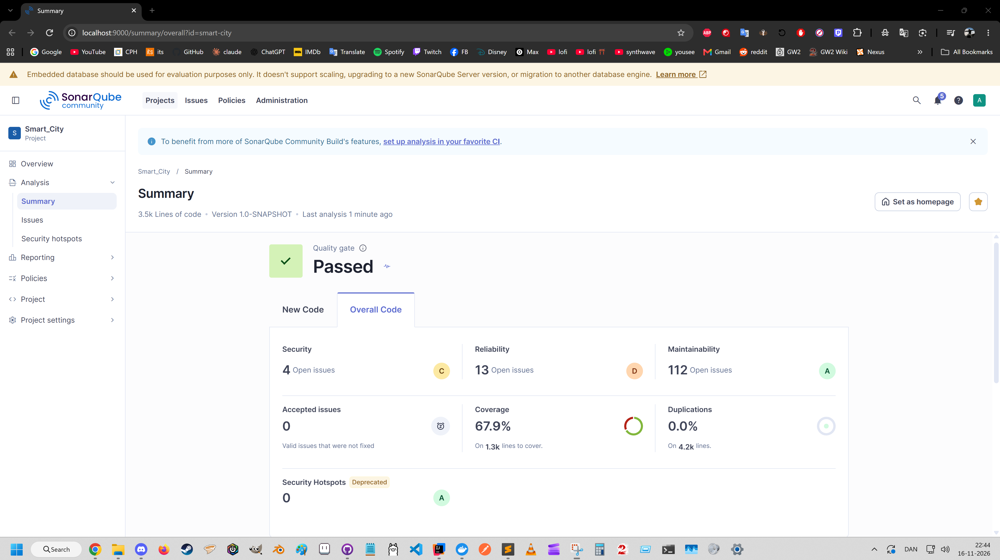
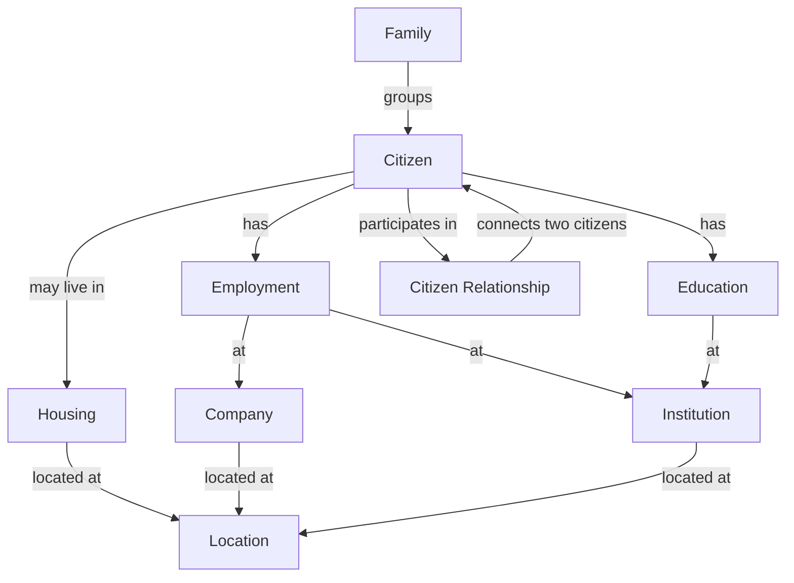
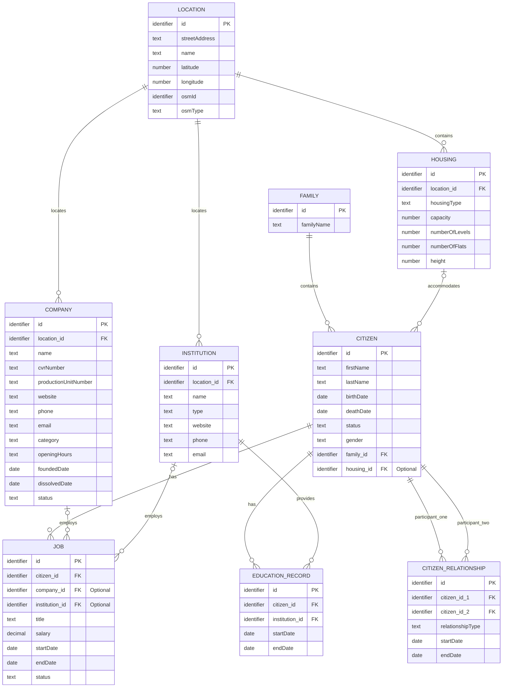

# Smart City

Smart City is a Java REST API for managing a simulated city: citizens, families, housing, locations, companies, institutions, jobs, education records, and citizen relationships. It uses a PostgreSQL database (run in Docker) and includes JWT authentication, CRUD endpoints, nearby-place lookup through OpenStreetMap's Overpass API, and admin-only tools for importing and enriching seed data.

| Part | Technology |
|---|---|
| Backend (REST API) | Java 17, Javalin 6, Maven |
| Persistence | Hibernate 6, JPA |
| Database | PostgreSQL 16 (Docker, with pg_cron) |
| Local services | Docker Compose: PostgreSQL, pgAdmin, MongoDB, Neo4j |
| Authentication | JWT (TokenSecurity), BCrypt password hashing |
| Mapping and JSON | MapStruct, Jackson |
| Unit tests | JUnit 5, Mockito, Hamcrest |
| HTTP and database integration tests | WireMock, REST Assured, Testcontainers |
| Static analysis | SonarQube Community Build (Docker) |
| API examples | Postman |
| Frontend (demo UI) | Vite, React 18, JavaScript |
| End-to-end UI tests | Playwright |

## Contents

1. [Quick start](#quick-start)
2. [Repository structure](#repository-structure)
3. [Prerequisites](#prerequisites)
4. [Step 1: Get the code](#step-1-get-the-code)
5. [Step 2: Databases (Docker)](#step-2-databases-docker)
6. [Step 3: Backend](#step-3-backend)
7. [Running the tests](#running-the-tests)
8. [Static analysis with SonarQube](#static-analysis-with-sonarqube)
9. [API tests with Postman](#api-tests-with-postman)
10. [Frontend demo](#frontend-demo)
11. [End-to-end tests with Playwright](#end-to-end-tests-with-playwright)
12. [API reference](#api-reference)
13. [Database design](#database-design)
14. [Migration to MongoDB and Neo4j](#migration-to-mongodb-and-neo4j)
15. [Continuous integration and delivery](#continuous-integration-and-delivery)
16. [More documentation](#more-documentation)
17. [Troubleshooting](#troubleshooting)

## Quick start

The databases run in Docker. Start them, load the schema and create the database users first (details in [Step 2](#step-2-databases-docker)), then run the backend:

```text
git clone https://github.com/Gervig/Smart-City.git
cd Smart-City
cd docker
docker compose up -d --build
docker compose exec db psql -U postgres -d smart_city -f /sql/schema/database_schema.sql
docker compose exec db psql -U postgres -d smart_city -f /sql/users/08_users.sql
cd ..
```

Create `src/main/resources/config.properties` (see [Configure the database and JWT](#configure-the-database-and-jwt)), then start the application from IntelliJ by running `app.Main` or use Maven:

```text
mvn clean package
java -jar target/app.jar
```

The API listens on <http://localhost:7070>. The Javalin route overview is at <http://localhost:7070/api/routes>.

## Repository structure

```text
Smart-City/
|-- src/main/java/app/
|   |-- Main.java                  Application entry point and exception handlers
|   |-- config/                    Hibernate and EntityManagerFactory setup
|   |-- controllers/               HTTP request handlers
|   |-- daos/                      Generic JPA data access
|   |-- dtos/                      API request and response models
|   |-- entities/                  JPA domain entities
|   |-- external/overpass/         Overpass HTTP clients and response models
|   |-- mappers/                   MapStruct entity/DTO mapping
|   |-- populators/                Role and user setup, deterministic data generators
|   |-- routes/                    CRUD, nearby-place, and seed route registration
|   |-- security/                  JWT filters, roles, users, and user DAO
|   |-- services/                  Business logic
|   `-- validators/                Request and domain validation
|-- src/test/java/app/
|   |-- daos/                      PostgreSQL/Testcontainers integration tests
|   |-- external/                  WireMock tests and opt-in Overpass smoke test
|   |-- services/                  Service unit tests
|   |-- validators/                 Validator tests
|   `-- ...                        Mapper, security, and generator tests
|-- SQL/                           PostgreSQL schema, users and privileges, routines, triggers, views, and event
|-- docker/                        Docker Compose setup: PostgreSQL (pg_cron), pgAdmin, MongoDB, Neo4j
|-- scripts/                       PowerShell backup, restore and compare scripts for PostgreSQL
|-- NoSQL/                         MongoDB and Neo4j structure scripts (used by the migrator)
|-- migrator/                      Separate app: one-time migration from PostgreSQL to MongoDB and Neo4j
|-- docs/                          SRS, assignment information, plans, and ERD diagrams
|-- postman/                       API collection and local environment
|-- frontend/                      Vite + React demo UI and Playwright E2E tests
|   |-- src/                       React app (pages, API helper, resource definitions)
|   |-- e2e/                       Playwright tests (auth.spec.js, crud.spec.js)
|   |-- vite.config.js             Dev server and proxy to the backend
|   `-- playwright.config.js       Test configuration
`-- pom.xml                        Dependencies, build, and test configuration
```

## Prerequisites

| Tool | Version | Used for |
|---|---|---|
| Git | Recent version | Cloning the repository |
| Java JDK | 17 | Building and running the backend |
| Maven | 3.8 or newer recommended | Build and test commands |
| Docker Desktop | Recent version | The local databases (PostgreSQL, pgAdmin, MongoDB, Neo4j) and the Testcontainers integration tests |
| PowerShell | Windows PowerShell 5 or newer | The backup scripts in `scripts/` and `NoSQL/setup.ps1` |
| Postman | Optional | Running the checked-in API collection |
| Node.js and npm | Node 20 or newer | Frontend demo and Playwright tests |

Check your installations:

```text
git --version
java -version
mvn --version
docker --version
node --version
npm --version
```

## Step 1: Get the code

```text
git clone https://github.com/Gervig/Smart-City.git
cd Smart-City
```

## Step 2: Databases (Docker)

The databases run in Docker, using the project's own setup in [`docker/`](docker/) (see [`docker/README.md`](docker/README.md) for everything below in more detail). It starts four containers:

| Service | Address | Login |
|---|---|---|
| PostgreSQL 16.2 (with `pg_cron`) | `localhost:5432`, database `smart_city` | `postgres` / `postgres` (admin only) |
| pgAdmin | <http://localhost:8080> | `admin@cphbusiness.dk` / `1234` |
| MongoDB 7 | `localhost:27017` | no login (development) |
| Neo4j 5 | <http://localhost:7474>, bolt on `7687` | `neo4j` / `smartcity-dev` |

These are development passwords, not secrets. Docker Desktop must be running.

**1. Start the containers** (the first start builds the PostgreSQL image and creates the `smart_city` database):

```text
cd docker
docker compose up -d --build
```

**2. Load the schema and create the database users.** The repository's `SQL/` folder is mounted in the database container as `/sql`:

```text
docker compose exec db psql -U postgres -d smart_city -f /sql/schema/database_schema.sql
docker compose exec db psql -U postgres -d smart_city -f /sql/users/08_users.sql
```

The schema comes from `SQL/schema/database_schema.sql`, not from Hibernate: the application only checks it on startup (`hibernate.hbm2ddl.auto` is `validate`), so it reports `missing table` if the schema was not loaded. `08_users.sql` creates four database users with different privileges (`smartcity_app` for the backend, `smartcity_admin`, `smartcity_readonly` and `smartcity_restricted`); the table of users and how to show their privileges are in [`docker/README.md`](docker/README.md#users).

**3. Stop or start over:**

```text
docker compose stop     # stop, keeping the data
docker compose down     # remove the containers, keeping the data
```

To start with an empty database, run `docker compose down`, delete `docker/data/` and repeat steps 1 and 2. The data folders are not committed.

Other things in the Docker setup are documented in [`docker/README.md`](docker/README.md): the daily statistics event (`pg_cron`), and database backup, restore and compare with the scripts in `scripts/`.

<!-- TODO(migrator): MongoDB and Neo4j are started by the same Compose file but are empty. When the migrator
documentation is added, mention here how to create their structure (NoSQL/setup.ps1) and link to the
"Migration to MongoDB and Neo4j" section. -->

### Configure the database and JWT

Create the ignored file `src/main/resources/config.properties` (do not commit it):

```properties
DB_NAME=smart_city
DB_USERNAME=smartcity_app
DB_PASSWORD=app-dev-password
ISSUER=smart-city-local
TOKEN_EXPIRE_TIME=1800000
SECRET_KEY=replace-with-a-long-random-secret
ADMIN_PASSWORD=choose-a-local-admin-password
```

`smartcity_app` is the application user created by `08_users.sql` (it can read and write rows but not change the schema). The application connects to `localhost:5432`. On every start the application creates what is missing: the roles `user` and `admin`, the user `admin` (only when `ADMIN_PASSWORD` is set) and the test users `User1` / `Password123` and `User2` / `Password456`. Existing rows are left alone, so a restart adds nothing.

`TOKEN_EXPIRE_TIME` is in milliseconds. Use a unique random `SECRET_KEY` outside local development; never put real credentials or signing keys in source control. The repository's `.gitignore` excludes `src/main/resources/config.properties`.

For deployment, set `DEPLOYED` and provide `DB_NAME`, `CONNECTION_STR`, `DB_USERNAME`, `DB_PASSWORD`, `ISSUER`, `TOKEN_EXPIRE_TIME`, `SECRET_KEY` and `ADMIN_PASSWORD` as environment variables. `OVERPASS_URL` is optional; when unset, the application uses the public Overpass interpreter endpoint.

## Step 3: Backend

Build and run from the project root:

```text
mvn clean package
java -jar target/app.jar
```

Alternatively, open the project in IntelliJ IDEA, allow Maven to import dependencies, and run `app.Main`. The server starts on port `7070`.

### Administrator account

The application creates the `admin` user on startup when `ADMIN_PASSWORD` is set in `config.properties` (or as an environment variable). If it is not set, the application logs `ADMIN_PASSWORD is not set: no admin user was created` and no administrator exists. The password is the one you chose; do not hard-code or commit it. Existing accounts are left alone, so changing `ADMIN_PASSWORD` later does not change the password of an existing `admin` user. Normal registrations receive the `user` role by default.

### Seed locations and sample data

The seed endpoints require an admin JWT. First import named locations from OSM, then generate fake domain data that references those locations, and optionally enrich entities from OSM tags. The operations are manual; the application does not seed data on startup.

```text
POST /api/admin/seed/locations
POST /api/admin/seed/fake?citizens=100&seed=42
POST /api/admin/seed/enrich
```

The locations endpoint defaults to a central Copenhagen bounding box, `amenity=hospital`, and a result limit of 20 (maximum 200). Fake data accepts 1–1000 citizens and requires at least one imported location. Overpass is a shared public service; keep requests modest and use the endpoint only when needed.

## Running the tests

Run the unit and non-database tests with:

```text
mvn test
```

Tests under `src/test/java/app/daos/` use real PostgreSQL through Testcontainers and are run by the Failsafe integration-test phase. Docker must be running. Run the full suite with:

```text
mvn clean verify
```

The Overpass import client tests use local WireMock responses and do not call the live service. The real Overpass smoke test is disabled by default; opt into it only when you want to send a request to the public API:

```text
mvn test -Dtest=OverpassLiveTest -Doverpass.live=true
```

#### Screenshot of JaCoCo report


`app.security.rest` contains controllers and routes and is therefore not covered by unit or integration tests, just like the main routes and controllers. Those are covered by the [API tests in Postman](#api-tests-with-postman).

## Static analysis with SonarQube

SonarQube (Community Build) analyses the source code without running it and reports bugs, vulnerabilities, security hotspots, code smells and duplication. It also shows the JaCoCo coverage from the test run. The server runs locally in Docker; nothing is sent to the cloud.

### Start the server

Docker Desktop must be running.

```text
docker run -d --name sonarqube -p 9000:9000 sonarqube:community
```

Startup takes 1 to 2 minutes. Open <http://localhost:9000>. Later, start and stop the same container with `docker start sonarqube` and `docker stop sonarqube`; removing it (`docker rm`) deletes the project and its history.

### First-time setup

1. Log in with `admin` / `admin` and choose a new password. It is stored only in your own container.
2. Create a local project with project key `smart-city` and choose **Use the global setting** for the new code definition.
3. Choose **Locally**, generate a token and copy it. The token is shown once; never commit it or paste it into shared files.

### Run an analysis

First run the tests so JaCoCo writes `target/site/jacoco/jacoco.xml`, then run the Sonar scanner. Use the full plugin name, because the short name `sonar:sonar` is not known to Maven by default:

```text
mvn clean verify
mvn org.sonarsource.scanner.maven:sonar-maven-plugin:5.9.0.7382:sonar "-Dsonar.projectKey=smart-city" "-Dsonar.host.url=http://localhost:9000" "-Dsonar.token=YOUR_TOKEN" "-Dsonar.coverage.jacoco.xmlReportPaths=target/site/jacoco/jacoco.xml" "-Dsonar.coverage.exclusions=**/*MapperImpl.java"
```

- The quotes are needed in PowerShell. In IntelliJ's **Execute Maven Goal** dialog, leave out `mvn` and the quotes.
- The scanner needs Java 21 and downloads its own runtime into `~/.sonar/cache` the first time, so the project itself stays on Java 17. If unpacking the runtime fails, delete that cache folder and run the command again.
- The coverage exclusion leaves out the generated MapStruct classes, as in the JaCoCo configuration. The controllers, routes, `app.security.rest` and `Main` are tested through Postman, not unit tests; to leave them out of Sonar's coverage figure as well, add `**/controllers/**`, `**/routes/**`, `**/security/rest/**` and `**/Main.java` to `sonar.coverage.exclusions`, and state that choice in the report.
- Commit your changes before an analysis. Sonar reads the blame data from git, and uncommitted files cause the warning "Missing blame information".
- The Community Build analyses one branch (shown as `main` in the dashboard), whichever branch you have checked out.

### Read the results

Open <http://localhost:9000/dashboard?id=smart-city> and use the **Overall Code** tab.

| Part | What it shows |
|---|---|
| Quality gate | Pass or fail against the default "Sonar way" conditions: no new issues, all new security hotspots reviewed, coverage of at least 80% and at most 3% duplication on new code |
| Issues | Bugs, vulnerabilities and code smells. Open one to read why it matters and how to fix it |
| Security Hotspots | Security-sensitive code that a person must review and mark as Safe or Fixed |
| Measures | Coverage (from JaCoCo), duplication, complexity and ratings from A to E |

A finding can be fixed, or set to **Accepted** or **False positive** with a comment explaining the decision. Run the analysis again after each round of fixes and compare the dashboards.

### SonarQube screenshots
#### First run

#### Example of an issue (GenericDAO mergeAllEntities)

### Latest run


Code coverage doesn't match the real picture, code for controllers and routes have been excluded for SonarQube coverage to pass quality gate. For real picture of code coverage, see the [Screenshot of JaCoCo report](#screenshot-of-jacoco-report).

## API tests with Postman

Import `postman/SmartCity.postman_collection.json` and the local environment from `postman/SmartCity.local.postman_environment.json`. Set the environment's base URL to `http://localhost:7070`, start the application, and use the collection's auth requests to register or log in before calling protected routes. The collection includes CRUD, authentication, nearby-place, and cleanup requests.

The `09 Jobs` folder uses an admin token, because only an admin can create jobs and see or set salaries. `00 Auth` gets it with "Login as admin", which uses the environment variable `adminPassword` (default `Admin123!`). It must match `ADMIN_PASSWORD` in your `config.properties`; change one of them if yours differs.

### Screenshot of Postman collection run


## Frontend demo

`frontend/` is a small Vite + React (JavaScript) app that demonstrates the API in a browser and is the system under test for the Playwright tests. It has pages to register, log in and log out, one CRUD page each for families, locations, housings and citizens, and a nearby-places page that calls `GET /locations/{id}/nearby`.

Start the backend first (port 7070, database running), then in a second terminal:

```text
cd frontend
npm install
npm run dev
```

The app is served on <http://localhost:5173>.

### How the frontend reaches the API

The backend has no CORS configuration, so the browser never calls it directly. Every request goes to `/backend/...` on the Vite dev server, which forwards it to `http://localhost:7070` and removes the `/backend` prefix (see `frontend/vite.config.js`). The backend therefore needs no changes. To point the frontend at another API, set `VITE_API_TARGET` before `npm run dev`.

### How it is built

| File | Purpose |
|---|---|
| `src/api.js` | One `request` helper; turns the API's error bodies (`{"error": ...}` and `{"msg": ...}`) into readable messages |
| `src/auth.jsx` | Login, register and logout; keeps the JWT in `localStorage` under `smartcity.auth` so a reload stays logged in |
| `src/resources.js` | Describes each CRUD resource (path, fields, types). Adding an entry creates a new page |
| `src/CrudPage.jsx` | Generic table and create/edit/delete form driven by `resources.js` |
| `src/NearbyPage.jsx` | Form and result list for nearby places |

Notes:

- A `401` from the API logs the user out and returns to the login page.
- Dates from the API may arrive as `[year, month, day]` arrays; the frontend shows them as `yyyy-mm-dd`.
- Access control is done by the backend (see [Role rules](#role-rules)): a normal user cannot see salaries or create jobs. The login redirect is only a frontend convenience.
- Elements carry `data-testid` attributes that the tests use as selectors.

## End-to-end tests with Playwright

The Playwright tests drive the real UI in Chromium against the real backend and database. They are written in code (`frontend/e2e/`) and are not recorded.

### Run the tests

1. Start the Docker databases (Step 2) and the backend on port 7070.
2. In `frontend/`:

```text
npm install
npx playwright install chromium
npm run e2e
```

Playwright starts the Vite dev server itself, or reuses one that is already running on port 5173. Other useful commands:

| Command | Effect |
|---|---|
| `npm run e2e` | Run all tests headless; prints a list and writes an HTML report |
| `npm run e2e:headed` | Run with a visible browser |
| `npm run e2e:ui` | Open Playwright's UI mode to step through tests |
| `npm run e2e:report` | Open the last HTML report (screenshots and traces of failures) |
| `npx playwright test e2e/auth.spec.js` | Run one file |
| `npx playwright test -g "wrong password"` | Run tests whose name matches |

Tests run one at a time (`workers: 1`) because they share one database. Each test creates its own user with a unique name, so the suite can be repeated without cleaning the database. The tests create and delete families, locations, housings and citizens; use a development database.

### What is tested

| File | Test | Type |
|---|---|---|
| `auth.spec.js` | Unauthenticated visitor is redirected to login | Negative |
| | Register a new user and land on the app | Positive |
| | Log in as an existing user | Positive |
| | Wrong password shows an error | Negative |
| | Unknown user cannot log in | Negative |
| | Empty login form is rejected | Negative |
| | Logout returns to login and blocks protected pages | Positive |
| | A `401` from the API logs the user out | Negative |
| `crud.spec.js` | Create, edit and delete a family | Positive |
| | Family without a name is rejected | Negative |
| | Create a location and a housing that points to it | Positive |
| | Housing with capacity 0 is rejected | Negative (boundary) |
| | Create a citizen linked to a family | Positive |
| | Citizen born in the future is rejected | Negative |
| | Alive citizen with a death date is rejected | Negative |
| | Citizen without a first name is rejected | Negative |
| | Nearby places show results (Overpass response stubbed with `page.route`) | Positive |
| | Unknown location shows an error | Negative |

The negative tests assert the validation messages from `src/main/java/app/validators/`. If a message is reworded in the backend, update the matching test.

### Design choices

- Tests sign in through the API and put the token in `localStorage` (`signIn` in `e2e/helpers.js`), so they start on the page under test instead of repeating the login form. Only `auth.spec.js` uses the login form.
- The nearby-places success test stubs the response, so the suite does not depend on the public Overpass service. The backend's own Overpass behaviour is covered by the WireMock tests and the opt-in `OverpassLiveTest`.
- Static analysis and JaCoCo coverage cover the backend only. The frontend is covered by these end-to-end tests.

### Screenshot of Playwright report


## API reference

All CRUD endpoints below are registered at the application root. Each resource supports `GET /<resource>`, `GET /<resource>/{id}`, `POST /<resource>`, `PUT /<resource>/{id}`, and `DELETE /<resource>/{id}`.

### Role rules

Users and administrators have full CRUD on all city data. The exception is a job's salary, which only administrators can see and set.

| Action | `ANYONE` (no token) | `USER` | `ADMIN` |
|---|---|---|---|
| `POST /api/auth/register`, `POST /api/auth/login` | Yes | Yes | Yes |
| `GET`, `POST`, `PUT`, `DELETE` on every CRUD resource except jobs, and `GET /locations/{id}/nearby` | 401 | Yes | Yes |
| `GET /jobs`, `GET /jobs/{id}` | 401 | Yes, `salary` is `null` | Yes, with salary |
| `PUT /jobs/{id}` | 401 | Yes, without `salary` (the stored salary is kept); sending a salary gives 403 | Yes |
| `DELETE /jobs/{id}` | 401 | Yes | Yes |
| `POST /jobs` (a job needs a salary) | 401 | 403 | Yes |
| `POST /api/admin/seed/*` | 401 | 403 | Yes |
| `POST /api/auth/logout` | 401 | Yes | Yes |

A missing, malformed, expired, tampered or logged-out token gives 401; a valid token without the needed role gives 403. The route roles are set in `Routes.java` (`USERS` and `ADMINS`) and the salary rule in `JobController.java`. It is the API counterpart of the database user `smartcity_restricted`, which can read every `job` column except `salary` (`SQL/users/08_users.sql`).

### Logout

`POST /api/auth/logout` ends the token sent in the `Authorization` header. Every token has a unique id (the `jti` claim); logout puts that id on a denylist until the token's expiry time, and the authorize filter rejects any token on the list with 401. Other tokens of the same user keep working. The denylist is kept in memory, so a restart clears it; a logged-out token is then accepted again until it expires (at most `TOKEN_EXPIRE_TIME`).

| Resource | Path |
|---|---|
| Locations | `/locations` |
| Families | `/families` |
| Housings | `/housings` |
| Citizens | `/citizens` |
| Citizen relationships | `/citizen-relationships` |
| Institutions | `/institutions` |
| Companies | `/companies` |
| Education records | `/education-records` |
| Jobs | `/jobs` |

Collection endpoints support zero-based pagination and filtering with `page` (default `0`), `size` (default `20`, maximum `100`), and `sort=field,asc|desc` (default `id,asc`). They return a JSON envelope containing `data`, `page`, `size`, `totalElements`, and `totalPages`; counts include all matching records. For example:

```text
GET /citizens?page=0&size=20&sort=familyId,asc&lastName=smith&birthDateFrom=1980-01-01&birthDateTo=2000-12-31
```

Sort and filter names are allowlisted per resource; relationship ID fields such as `familyId`, `housingId`, and `locationId` address the related entity IDs. Unsupported fields, invalid filter values, invalid page or size values, and invalid sort directions return HTTP 400. A page beyond the last page returns an empty `data` array. String filters use case-insensitive partial matching. Available filters are:

| Resource | Filters |
|---|---|
| Citizens | `status`, `lastName`, `birthDateFrom`, `birthDateTo`, `familyId`, `housingId` |
| Families | `familyName` |
| Housings | `locationId`, `housingType`, `capacityFrom`, `capacityTo` |
| Locations | `name`, `streetAddress` |
| Companies | `locationId`, `name`, `status`, `foundedDateFrom`, `foundedDateTo` |
| Institutions | `locationId`, `name`, `type` |
| Jobs | `citizenId`, `companyId`, `institutionId`, `title`, `status`, `salaryFrom`, `salaryTo`, `startDateFrom`, `startDateTo`, `endDateFrom`, `endDateTo` |
| Education records | `citizenId`, `institutionId`, `startDateFrom`, `startDateTo`, `endDateFrom`, `endDateTo` |
| Citizen relationships | `citizenId1`, `citizenId2`, `relationshipType`, `startDateFrom`, `startDateTo`, `endDateFrom`, `endDateTo` |

| Method | Path | Access | Description |
|---|---|---|---|
| POST | `/api/auth/register` | Public | Register a user; new accounts receive the `user` role. 201 with username and roles; 400 for a missing username or password or a password under 8 characters; 409 for a taken username |
| POST | `/api/auth/login` | Public | Verify credentials and return a JWT. 400 for a missing username or password; 401 for a wrong password or unknown user |
| POST | `/api/auth/logout` | `USER`, `ADMIN` | Log out: the token in the request is rejected from now on |
| GET | `/api/secured/demo` | `USER` | Verify a user token |
| GET | `/locations/{id}/nearby?radius=1000&amenity=hospital` | `USER`, `ADMIN` | Find nearby OSM places for a location |
| POST | `/api/admin/seed/locations?south=...&west=...&north=...&east=...&amenity=hospital&limit=20` | `ADMIN` | Import named OSM locations; coordinates and query options are optional |
| POST | `/api/admin/seed/fake?citizens=100&seed=42` | `ADMIN` | Generate deterministic related fake records |
| POST | `/api/admin/seed/enrich` | `ADMIN` | Fill missing fields from OSM tags |

For protected routes, send the token returned by login as `Authorization: Bearer <token>`. See [Role rules](#role-rules) for which role each route needs.

Registration and login accept JSON credentials, for example:

```json
{
  "username": "city-user",
  "password": "a-local-password"
}
```

The route overview is available at `/api/routes` while the application is running. Error responses and exact request fields depend on the corresponding DTOs and validators in `src/main/java/app/dtos/` and `src/main/java/app/validators/`.

## Database Design

The database design follows three stages of relational database modelling:

#### 1. Conceptual Model



The conceptual model provides a high-level overview of the Smart City domain. It identifies the main entities and illustrates how they interact, without including implementation details such as attributes, primary keys or foreign keys.

#### 2. Logical Model



The logical model expands on the conceptual design by defining the attributes of each entity, identifying primary and foreign keys, and specifying the relationships and cardinalities between entities.

It is independent of the database management system and focuses on the logical organization of the data.

#### 3. Physical Model (Entity Relationship Diagram)
````mermaid

erDiagram
    family {
        BIGINT id PK
        VARCHAR family_name
    }

    citizen {
        BIGINT id PK
        VARCHAR first_name
        VARCHAR last_name
        DATE birth_date
        DATE death_date
        VARCHAR status
        VARCHAR gender
        BIGINT family_id FK
        BIGINT housing_id FK
    }

    housing {
        BIGINT id PK
        BIGINT location_id FK
        VARCHAR housing_type
        INTEGER capacity
        INTEGER number_of_levels
        INTEGER number_of_flats
        DOUBLE_PRECISION height
    }

    location {
        BIGINT id PK
        VARCHAR street_address
        VARCHAR name
        DOUBLE_PRECISION latitude
        DOUBLE_PRECISION longitude
        BIGINT osm_id
        VARCHAR osm_type
    }

    company {
        BIGINT id PK
        BIGINT location_id FK
        VARCHAR name
        VARCHAR cvr_number
        VARCHAR production_unit_number
        VARCHAR website
        VARCHAR phone
        VARCHAR email
        VARCHAR category
        VARCHAR opening_hours
        DATE founded_date
        DATE dissolved_date
        VARCHAR status
    }

    institution {
        BIGINT id PK
        BIGINT location_id FK
        VARCHAR name
        VARCHAR type
        VARCHAR website
        VARCHAR phone
        VARCHAR email
    }

    job {
        BIGINT id PK
        BIGINT citizen_id FK
        BIGINT company_id FK
        BIGINT institution_id FK
        VARCHAR title
        NUMERIC salary
        DATE start_date
        DATE end_date
        VARCHAR status
    }

    education_record {
        BIGINT id PK
        BIGINT citizen_id FK
        BIGINT institution_id FK
        DATE start_date
        DATE end_date
    }

    citizen_relationship {
        BIGINT id PK
        BIGINT citizen_id_1 FK
        BIGINT citizen_id_2 FK
        VARCHAR relationship_type
        DATE start_date
        DATE end_date
    }

    family ||--o{ citizen : has
    housing o|--o{ citizen : houses
    location ||--o{ housing : contains
    location ||--o{ company : locates
    location ||--o{ institution : locates

    citizen ||--o{ job : has
    company o|--o{ job : employs
    institution o|--o{ job : employs

    citizen ||--o{ education_record : has
    institution ||--o{ education_record : provides

    citizen ||--o{ citizen_relationship : participant_one
    citizen ||--o{ citizen_relationship : participant_two

````
The physical model translates the logical design into a database structure. It specifies the database tables, columns, SQL data types, primary keys and foreign keys.

The database schema is created by `SQL/schema/database_schema.sql` (loaded in [Step 2](#step-2-databases-docker)). The application uses PostgreSQL with Hibernate and JPA, but Hibernate only validates that the Java entity classes match the schema (`hibernate.hbm2ddl.auto` is `validate`). The other scripts in `SQL/` (users and privileges, functions, procedures, triggers, views and the daily event) are applied the same way.

The three models represent different levels of detail of the same Smart City domain.

## Migration to MongoDB and Neo4j

<!-- TODO(migrator): fill in this section when the migrator documentation is added. Suggested structure:
1. Overview: what the migrator does (one-time migration of the PostgreSQL data into MongoDB and Neo4j), and a flow diagram.
2. Structure and data are separate: table of NoSQL/mongodb/01_collections.js and NoSQL/neo4j/01_constraints.cypher.
3. How the migrator works: read, map, write, report.
4. MongoDB design: collections, embedded versus referenced.
5. Neo4j design: nodes and relationships.
6. Run it: Docker, NoSQL/setup.ps1, java -jar target/migrator.jar, settings, exit codes.
7. Migrator tests: mvn test and mvn verify.
See migrator/README.md for the source material. -->

_Overview:_ to be added

_Document design (MongoDB):_ to be added

_Graph design (Neo4j):_ to be added

_Run the migration:_ to be added

_Migrator tests:_ to be added

## Continuous integration and delivery

No CI/CD workflow is currently checked into this repository. Before submitting changes, run `mvn clean verify`; this runs the Surefire tests and, with Docker available, the PostgreSQL-backed Failsafe tests. The Playwright tests are run separately with `npm run e2e` in `frontend/` while the backend is running.

## More documentation

- [Software Requirements Specification](<docs/Smart City SRS (v2).md>)

- [Exam assignment description](docs/Exam_Assignment_Description.md)
- [Exam information](docs/Exam_Information.md)
- [Postman collection](postman/SmartCity.postman_collection.json)
- [Playwright tests](frontend/e2e/)
- [Overpass API documentation](https://wiki.openstreetmap.org/wiki/Overpass_API)

## Troubleshooting

| Problem | Check |
|---|---|
| Database connection fails | The Docker containers are running (`docker compose ps` in `docker/`), and the `DB_NAME`, `DB_USERNAME` and `DB_PASSWORD` values in `config.properties` match a database user (see Step 2). |
| Startup fails with `Schema-validation: missing table` | The schema was not loaded into the database. Run `database_schema.sql` as described in Step 2. |
| `port is already allocated` when starting Docker | Another PostgreSQL is using port 5432. Stop it, or run `docker compose down` in `docker/` to remove old containers. |
| Application reports missing properties | Confirm `src/main/resources/config.properties` exists and contains all database and JWT keys shown above. |
| Existing data disappeared | The database was recreated: `docker/data/` was deleted or the schema script was loaded again. Take a backup first with `scripts/backup.ps1` (see [`docker/README.md`](docker/README.md)). |
| `mvn verify` cannot start database tests | Start Docker Desktop and make sure Testcontainers can access its Docker engine. |
| A protected request returns 401 | Log in and send the returned JWT in the `Authorization: Bearer ...` header. |
| An admin seed request returns 403 | The `admin` user does not exist or you are not logged in as admin. Set `ADMIN_PASSWORD` in `config.properties`, restart the backend, then log in as `admin`. |
| `mvn` is not recognized in PowerShell | Maven is not on your PATH. Run the goals from IntelliJ's Maven tool window (Execute Maven Goal), or install Maven. |
| Sonar scanner says `No plugin found for prefix 'sonar'` | Use the full plugin name `org.sonarsource.scanner.maven:sonar-maven-plugin:5.9.0.7382:sonar`. |
| Sonar scanner fails to extract the JRE or says Java 17 is not supported | The scanner needs Java 21. Delete `~/.sonar/cache` and run it again so it downloads its own runtime. |
| Sonar warns about missing blame information | Commit your changes and run the analysis again. |
| `npm run e2e` fails with "Executable doesn't exist" | Run `npx playwright install chromium` in `frontend/`. |
| Frontend pages show "Cannot reach the server" or a 500 error | The backend is not running on port 7070, or `VITE_API_TARGET` points elsewhere. |
| Port 5173 is already in use | Stop the other Vite process; the dev server is configured with `strictPort`. |
| Playwright tests time out waiting for the page | Check that the backend is up and that the Docker database is running with the schema loaded. |
| Overpass request fails or times out | The public service may be busy or rate-limiting requests. Retry later, or configure another compatible endpoint with `OVERPASS_URL`. |
