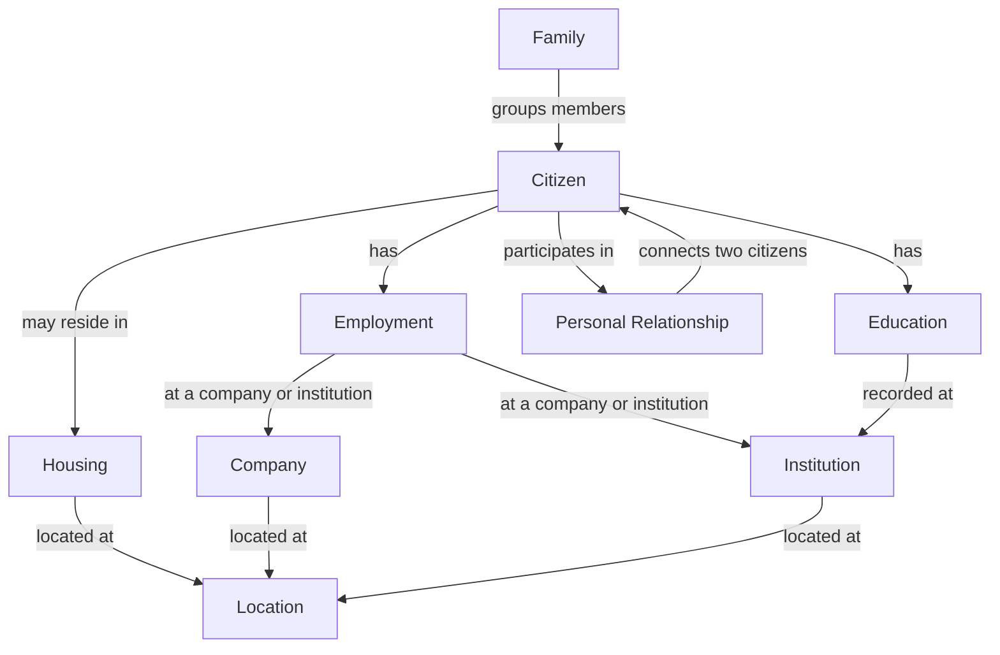
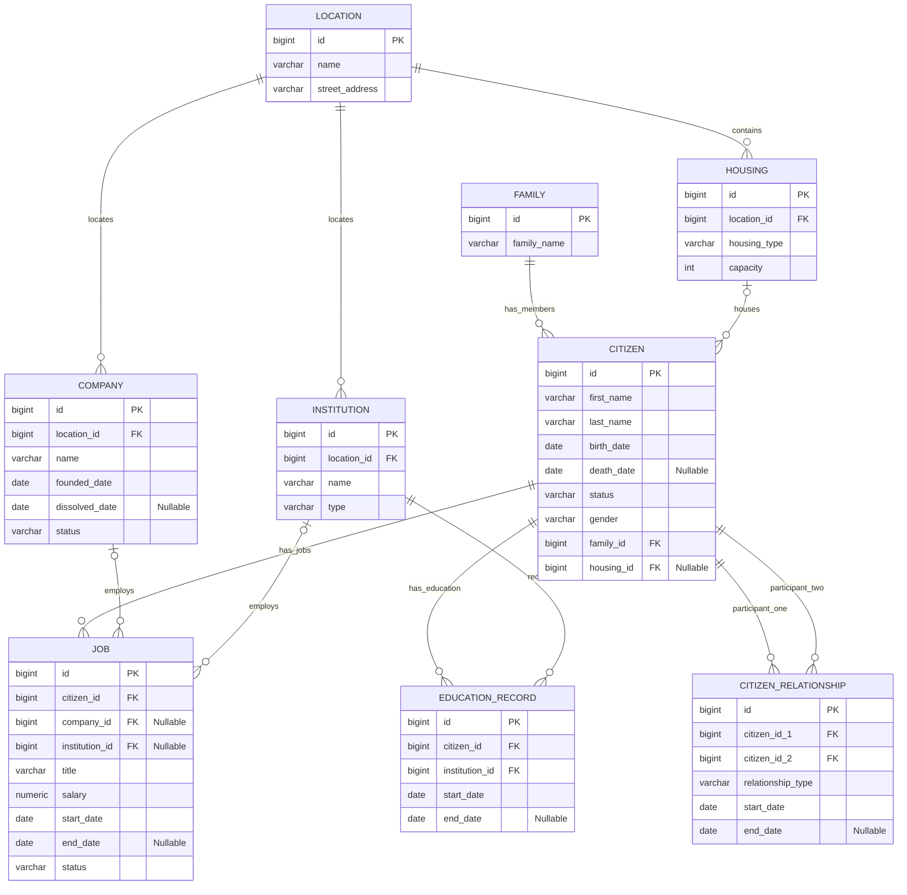
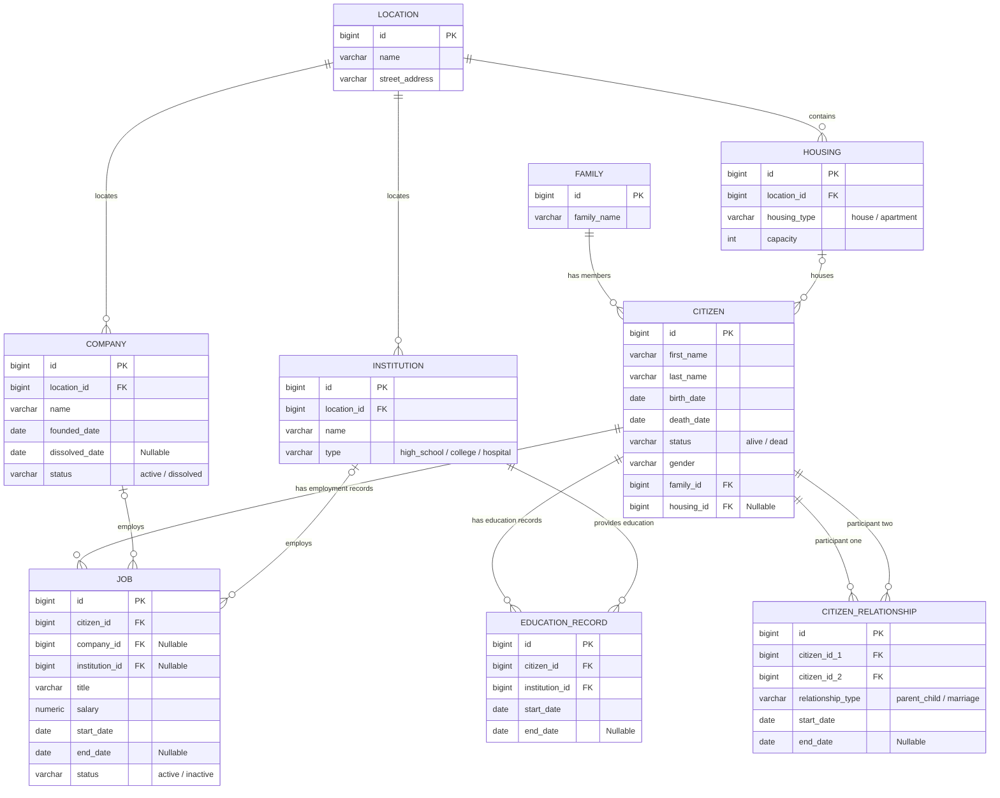

# Smart City

Smart City is a Java REST API for managing a simulated city: citizens, families, housing, locations, companies, institutions, jobs, education records, and citizen relationships. It uses a PostgreSQL database and includes JWT authentication, CRUD endpoints, nearby-place lookup through OpenStreetMap's Overpass API, and admin-only tools for importing and enriching seed data.

| Part | Technology |
|---|---|
| Backend (REST API) | Java 17, Javalin 6, Maven |
| Persistence | Hibernate 6, JPA |
| Database | PostgreSQL |
| Authentication | JWT (TokenSecurity), BCrypt password hashing |
| Mapping and JSON | MapStruct, Jackson |
| Unit tests | JUnit 5, Mockito, Hamcrest |
| HTTP and database integration tests | WireMock, REST Assured, Testcontainers |
| API examples | Postman |

## Contents

1. [Quick start](#quick-start)
2. [Repository structure](#repository-structure)
3. [Prerequisites](#prerequisites)
4. [Step 1: Get the code](#step-1-get-the-code)
5. [Step 2: Database](#step-2-database)
6. [Step 3: Backend](#step-3-backend)
7. [Running the tests](#running-the-tests)
8. [API tests with Postman](#api-tests-with-postman)
9. [API reference](#api-reference)
10. [Database design and SQL](#database-design-and-sql)
11. [Continuous integration and delivery](#continuous-integration-and-delivery)
12. [More documentation](#more-documentation)
13. [Troubleshooting](#troubleshooting)

## Quick start

This project does not include a Docker Compose file. Start a local PostgreSQL database first, configure the application as described in [Step 2](#step-2-database), then run the backend:

```text
git clone https://github.com/Gervig/Smart-City.git
cd Smart-City
```

Create `src/main/resources/config.properties` with local database credentials and non-production JWT values, then start the application from IntelliJ by running `app.Main` or use Maven:

```text
mvn clean package
java -jar target/app.jar
```

The API listens on <http://localhost:7070>. The Javalin route overview is at <http://localhost:7070/api/routes>.

> **Warning:** The current Hibernate development configuration uses `hibernate.hbm2ddl.auto=create`. Starting the application recreates the schema and deletes existing database data. Use only a disposable development database unless this configuration has been changed.

## Repository structure

```text
Smart-City/
|-- src/main/java/app/
|   |-- Main.java                  Application entry point and exception handlers
|   |-- config/                    Hibernate and EntityManagerFactory setup
|   |-- controllers/               HTTP request handlers
|   |-- daos/                      Generic JPA data access
|   |-- dtos/                      API request and response models
|   |-- entities/                  JPA domain entities
|   |-- external/overpass/         Overpass HTTP clients and response models
|   |-- mappers/                   MapStruct entity/DTO mapping
|   |-- populators/                Role and user setup, deterministic data generators
|   |-- routes/                    CRUD, nearby-place, and seed route registration
|   |-- security/                  JWT filters, roles, users, and user DAO
|   |-- services/                  Business logic
|   `-- validators/                Request and domain validation
|-- src/test/java/app/
|   |-- daos/                      PostgreSQL/Testcontainers integration tests
|   |-- external/                  WireMock tests and opt-in Overpass smoke test
|   |-- services/                  Service unit tests
|   |-- validators/                 Validator tests
|   `-- ...                        Mapper, security, and generator tests
|-- SQL/                           PostgreSQL schema, routines, triggers, views, and event
|-- docs/                          SRS, assignment information, plans, and ERD diagrams
|-- postman/                       API collection and local environment
`-- pom.xml                        Dependencies, build, and test configuration
```

## Prerequisites

| Tool | Version | Used for |
|---|---|---|
| Git | Recent version | Cloning the repository |
| Java JDK | 17 | Building and running the backend |
| Maven | 3.8 or newer recommended | Build and test commands |
| PostgreSQL | Supported PostgreSQL version | Local application database |
| Docker Desktop | Recent version | Testcontainers database integration tests |
| Postman | Optional | Running the checked-in API collection |

Check your installations:

```text
git --version
java -version
mvn --version
docker --version
```

## Step 1: Get the code

```text
git clone https://github.com/Gervig/Smart-City.git
cd Smart-City
```

## Step 2: Database

The application connects to PostgreSQL on `localhost:5432` in development. There is no Compose configuration in this repository. You can install PostgreSQL locally or use the course's [Docker setup instructions](https://github.com/dat2Cph/2semDockerSetupLocal/tree/main).

Create the database named in `DB_NAME` and create a database user with permission to connect and create tables. The ORM creates the entity schema when the application starts; the SQL scripts in `SQL/` are separate database-assignment materials and are not automatically executed by the application.

### Configure the database and JWT

Create the ignored file `src/main/resources/config.properties` (do not commit it):

```properties
DB_NAME=smart_city
DB_USERNAME=your_local_database_user
DB_PASSWORD=your_local_database_password
ISSUER=smart-city-local
TOKEN_EXPIRE_TIME=1800000
SECRET_KEY=replace-with-a-long-random-secret
```

`TOKEN_EXPIRE_TIME` is in milliseconds. Use a unique random `SECRET_KEY` outside local development; never put real credentials or signing keys in source control. The repository's `.gitignore` excludes `src/main/resources/config.properties`.

For deployment, set `DEPLOYED` and provide `DB_NAME`, `CONNECTION_STR`, `DB_USERNAME`, `DB_PASSWORD`, `ISSUER`, `TOKEN_EXPIRE_TIME`, and `SECRET_KEY` as environment variables. `OVERPASS_URL` is optional; when unset, the application uses the public Overpass interpreter endpoint.

## Step 3: Backend

Build and run from the project root:

```text
mvn clean package
java -jar target/app.jar
```

Alternatively, open the project in IntelliJ IDEA, allow Maven to import dependencies, and run `app.Main`. The server starts on port `7070`.

### Add an administrator manually

Administrator creation is deliberately not automatic. Set `ADMIN_PASSWORD` to a non-blank value, start the application so Hibernate has initialized the schema, then invoke this method manually from the IDE or a one-off application call:

```java
AdminPopulator.populate(HibernateConfig.getEntityManagerFactory());
```

It creates the `admin` account if needed and ensures it has the `admin` role. Do not hard-code or commit the password. Normal registrations receive the `user` role by default.

### Seed locations and sample data

The seed endpoints require an admin JWT. First import named locations from OSM, then generate fake domain data that references those locations, and optionally enrich entities from OSM tags. The operations are manual; the application does not seed data on startup.

```text
POST /api/admin/seed/locations
POST /api/admin/seed/fake?citizens=100&seed=42
POST /api/admin/seed/enrich
```

The locations endpoint defaults to a central Copenhagen bounding box, `amenity=hospital`, and a result limit of 20 (maximum 200). Fake data accepts 1–1000 citizens and requires at least one imported location. Overpass is a shared public service; keep requests modest and use the endpoint only when needed.

## Running the tests

Run the unit and non-database tests with:

```text
mvn test
```

Tests under `src/test/java/app/daos/` use real PostgreSQL through Testcontainers and are run by the Failsafe integration-test phase. Docker must be running. Run the full suite with:

```text
mvn clean verify
```

The Overpass import client tests use local WireMock responses and do not call the live service. The real Overpass smoke test is disabled by default; opt into it only when you want to send a request to the public API:

```text
mvn test -Dtest=OverpassLiveTest -Doverpass.live=true
```

#### Screenshot of JaCoCo report


app.security.rest contains controllers and routes and are therefor not covered in integration or unit test, just like the main routes and controllers. Those are covered with API tests in Postman.

## API tests with Postman

Import `postman/SmartCity.postman_collection.json` and the local environment from `postman/SmartCity.local.postman_environment.json`. Set the environment's base URL to `http://localhost:7070`, start the application, and use the collection's auth requests to register or log in before calling protected routes. The collection includes CRUD, authentication, nearby-place, and cleanup requests.

#### Screenshot of Postman collection run


## API reference

All CRUD endpoints below are registered at the application root. Each resource supports `GET /<resource>`, `GET /<resource>/{id}`, `POST /<resource>`, `PUT /<resource>/{id}`, and `DELETE /<resource>/{id}`.

| Resource | Path |
|---|---|
| Locations | `/locations` |
| Families | `/families` |
| Housings | `/housings` |
| Citizens | `/citizens` |
| Citizen relationships | `/citizen-relationships` |
| Institutions | `/institutions` |
| Companies | `/companies` |
| Education records | `/education-records` |
| Jobs | `/jobs` |

| Method | Path | Access | Description |
|---|---|---|---|
| POST | `/api/auth/register` | Public | Register a user; new accounts receive the `user` role |
| POST | `/api/auth/login` | Public | Verify credentials and return a JWT |
| GET | `/api/secured/demo` | `USER` | Verify a user token |
| GET | `/locations/{id}/nearby?radius=1000&amenity=hospital` | No route role configured | Find nearby OSM places for a location |
| POST | `/api/admin/seed/locations?south=...&west=...&north=...&east=...&amenity=hospital&limit=20` | `ADMIN` | Import named OSM locations; coordinates and query options are optional |
| POST | `/api/admin/seed/fake?citizens=100&seed=42` | `ADMIN` | Generate deterministic related fake records |
| POST | `/api/admin/seed/enrich` | `ADMIN` | Fill missing fields from OSM tags |

For protected routes, send the token returned by login as `Authorization: Bearer <token>`. CRUD and nearby-place routes currently have no route roles configured; they should not be treated as access-controlled endpoints.

Registration and login accept JSON credentials, for example:

```json
{
  "username": "city-user",
  "password": "a-local-password"
}
```

The route overview is available at `/api/routes` while the application is running. Error responses and exact request fields depend on the corresponding DTOs and validators in `src/main/java/app/dtos/` and `src/main/java/app/validators/`.

## Database design and SQL

#### Conceptual Model



#### Logical Model



#### Entity Relationship Diagram (ERD)



The JPA entities in `src/main/java/app/entities/` model citizens, families, housing, locations, companies, institutions, jobs, education records, and relationships. The diagrams under `docs/erd/` show the conceptual and relational models.

`SQL/` contains PostgreSQL assignment scripts, including schema definitions, stored functions and procedures, triggers, views, and a `pg_cron` event example. These scripts are maintained separately from Hibernate's runtime schema creation; review the target database carefully before executing any destructive SQL script.

## Continuous integration and delivery

No CI/CD workflow is currently checked into this repository. Before submitting changes, run `mvn clean verify`; this runs the Surefire tests and, with Docker available, the PostgreSQL-backed Failsafe tests.

## More documentation

- [Software Requirements Specification](<docs/Smart City SRS (v2).md>)

- [Exam assignment description](docs/Exam_Assignment_Description.md)
- [Exam information](docs/Exam_Information.md)
- [Postman collection](postman/SmartCity.postman_collection.json)
- [Overpass API documentation](https://wiki.openstreetmap.org/wiki/Overpass_API)

## Troubleshooting

| Problem | Check |
|---|---|
| Database connection fails | PostgreSQL is running, the database exists, and the `DB_NAME`, `DB_USERNAME`, and `DB_PASSWORD` values in `config.properties` are correct. |
| Application reports missing properties | Confirm `src/main/resources/config.properties` exists and contains all database and JWT keys shown above. |
| Existing data disappeared after startup | The development Hibernate setting uses `create`, which recreates tables. Use a disposable database and change the schema-generation setting before preserving data. |
| `mvn verify` cannot start database tests | Start Docker Desktop and make sure Testcontainers can access its Docker engine. |
| A protected request returns 401 | Log in and send the returned JWT in the `Authorization: Bearer ...` header. |
| An admin seed request returns 403 | Create the admin account manually using `AdminPopulator`, then log in as `admin`. |
| Overpass request fails or times out | The public service may be busy or rate-limiting requests. Retry later, or configure another compatible endpoint with `OVERPASS_URL`. |
