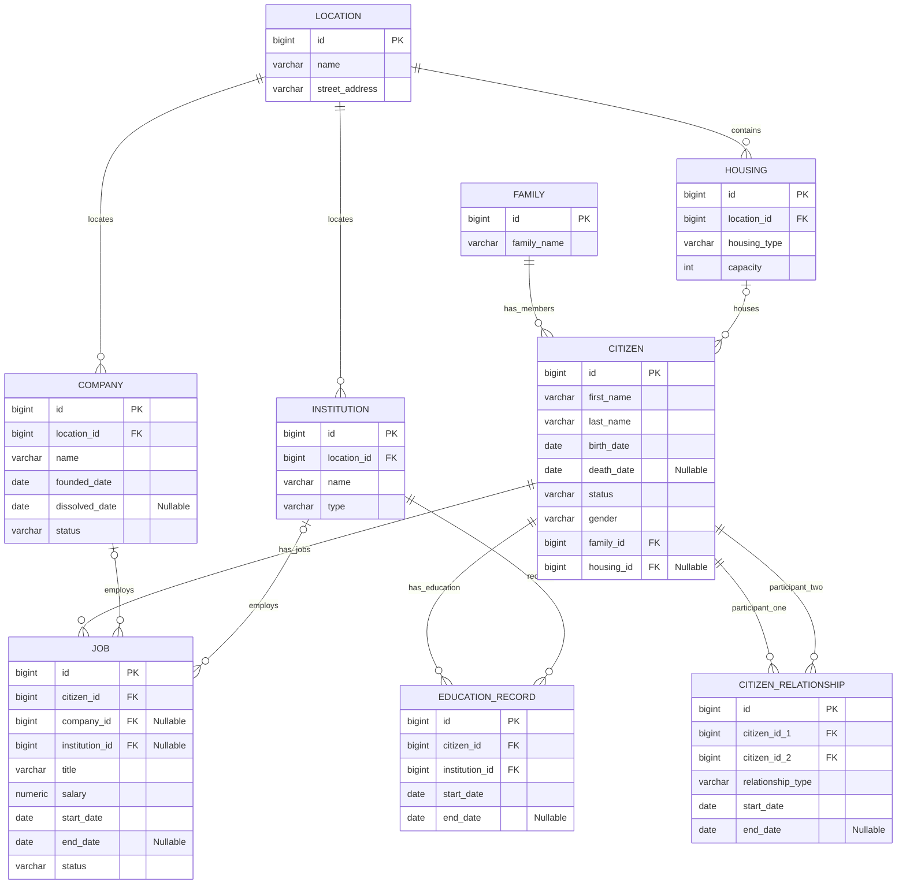
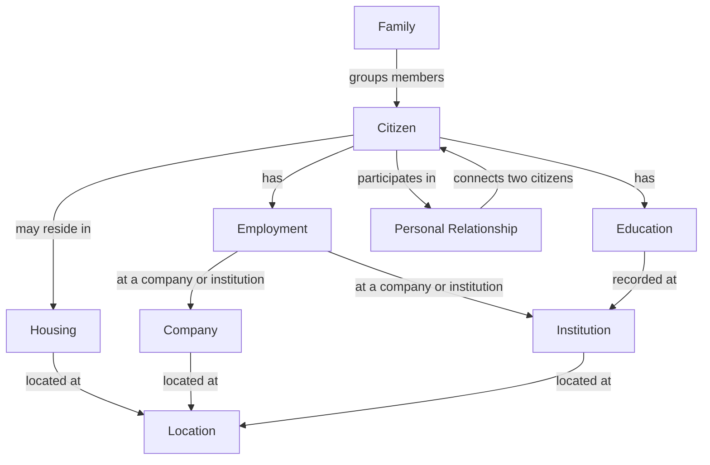
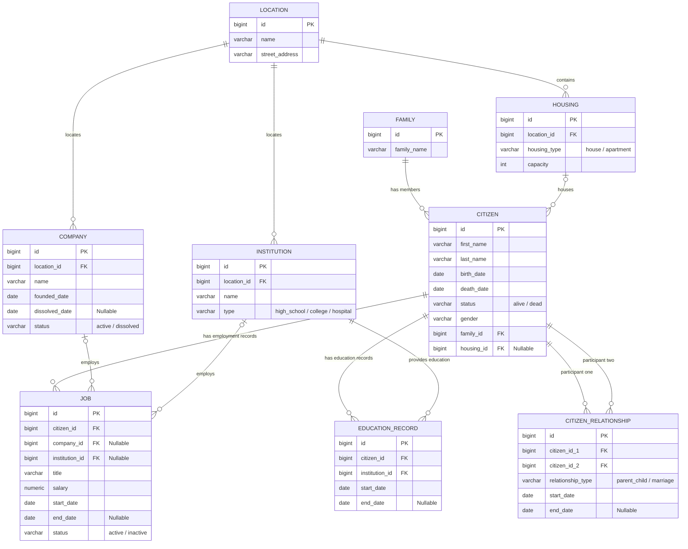

# Smart City
Smart City - database school project

## Project status

The current repository contains the initial domain ERD for the **World Sim**
project. The implementation must satisfy the final-project requirements:
PostgreSQL, MongoDB, and Neo4j solutions; a CRUD backend; a one-time migrator;
authentication and authorization; integration tests; Docker-based local
development; cloud deployment; and persisted AI-based data enrichment.

The scoped implementation plan is in
[docs/PROJECT_PLAN.md](docs/PROJECT_PLAN.md). It defines the core workflows,
database responsibilities, delivery phases, and definition of done.

## Smart City "World Sim" - Entity Relationship Diagram (ERD)

This document outlines the database schema for the persistent simulated city project. It provides a structured foundation for tracking citizens, companies, relationships, real estate, and education history.

### Relational Database Design

#### 1.1 Mermaid Logical Model

#### 1.2 Mermaid Conceptual Model

#### 1.3 Mermaid ERD

### 2. Core Tables Explained

#### Citizens & Connections
* **CITIZEN:** The foundation of the sim. Tracks lifetime, current living arrangements, and survival state.
* **RELATIONSHIP:** A bridge / junction table handling many-to-many dynamics between citizens. It records relationships explicitly with type tracking (e.g., historical marriages, parental links, or friendships).

#### Economy & Corporate Tracking
* **COMPANY:** Represents organizations. Built with a self-referencing foreign key (`parent_company_id`) to naturally store corporate takeovers, spin-offs, and mergers.
* **FINANCIAL_RECORD:** A clean time-series design. By utilizing a `period_type` column ("Daily", "Monthly", etc.), a single table elegantly tracks historical growth or decline without splitting schemas.
* **JOB:** Bridges citizens and corporations, maintaining a historical record of employment durations and wages.

#### Geography & Education
* **LOCATION:** Base infrastructure records mapping physical footprints across the city grid.
* **HOUSING:** Real estate footprints handling multi-family settings like apartment complexes mapping back to specific structural locations.
* **INSTITUTION:** Physical entities managing community operations (Schools, Hospitals).
* **EDUCATION_RECORD:** Captures academic tiers (HighSchool, College) paired with specific study focuses (Physics, Medical) across a citizen's timeline.

TODO: Reorder these artifacts

### Software Requirements Specification (SRS)
[SRS - Google docs link](https://docs.google.com/document/d/12_43twPTbJcp6sJGZI9ZfkHtgFDJzKRZcqeY4K8tuIw/edit?tab=t.0#heading=h.xve90k1d8rc2)

### Risk Analysis
[Risk Analysis - Google sheets link](https://docs.google.com/spreadsheets/d/1ew919fExgJMIeMAAf5ztmnJAFyG2TaIuBE_qwhcSv_I/edit?gid=0#gid=0)

### Acceptance Tests
[Acceptance Tests - Google sheets link](https://docs.google.com/spreadsheets/d/1OMXN2rE2uSHdAYjLs14SVel9g7b5vcNSDFF7bDAyxZY/edit?gid=1851569622#gid=1851569622)

### Google docs
TODO: Mention Database mandatory assignments?

[Smart City - Google docs link](https://docs.google.com/document/d/1vAISXsvhitFOSEO3KfKvNpljURQvqeAmGPBwtWO8zm4/edit?tab=t.0#heading=h.hd4ixaikuq76)

# JPA Template
This project was initialized using a JPA template for creating REST APIs using Java, JPA, Lombok, Javalin and Hibernate.

# Endpoint Table

| Endpoints                         | Method | Secured      | Description                     |
|:----------------------------------|:-------|:------------:|:--------------------------------|
| api/auth/register                 | POST   | ❌          | Create a new user               |
| api/auth/login                    | POST   | ❌          | Auth a user, return JWT token   |
| api/secured/demo                  | GET    | ✅          | Tests a users token after login |

❌ = Not secured

✅ = User secured

🔒 = Admin secured